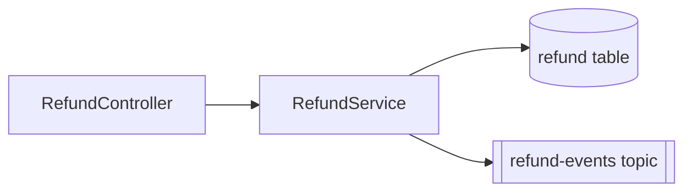
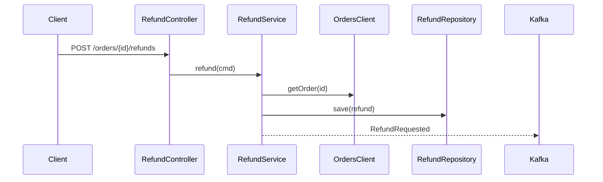

# {KEY} {Feature name} - LLD - {team}

- Jira: {KEY}   Team: {team}   Repository: {repo}
- Sources: one pager {link v}, HLD {link v}, test design {link v} (approved: yes/no), other LLDs {links}
- Status: Draft until a tech lead approves it in Jira. Design only: no implementation code.

## 1. Context and scope

What the HLD asks of this team, in two or three sentences. In scope / out of scope.

## 2. Requirements traceability

| Requirement (one pager / HLD) | Design element (section) | Test scenarios |
| --- | --- | --- |
| R-01 refund a paid order within 30 days | 4.1 POST /refunds, 5 refund table | TS-01, TS-02 |

## 3. Current state

The relevant parts of the code today, with file references (from the project profile and the
code): modules, classes, data flows this change touches.

## 4. Design

### 4.1 Components and responsibilities

New and changed classes/modules and what each is responsible for. A Mermaid diagram if useful:



### 4.2 API contracts

For each endpoint: method, path, auth (roles/scopes), request schema, response schemas per
status code, error codes, idempotency, pagination, versioning, backward compatibility.

```yaml
# OpenAPI fragment
paths:
  /orders/{orderId}/refunds:
    post:
      security: [{oauth2: [refunds:write]}]
      parameters:
        - {name: Idempotency-Key, in: header, required: true, schema: {type: string, format: uuid}}
      requestBody:
        content:
          application/json:
            schema:
              type: object
              required: [amount, reason]
              properties:
                amount: {type: string, pattern: "^[0-9]+\\.[0-9]{2}$"}
                reason: {type: string, enum: [DAMAGED, NOT_RECEIVED, OTHER]}
      responses:
        "201": {description: created, content: {application/json: {schema: {$ref: "#/components/schemas/Refund"}}}}
        "404": {description: order not found or not the caller's}
        "409": {description: "REFUND_WINDOW_CLOSED | ALREADY_REFUNDED"}
```

### 4.3 Events and messages

Topic/queue, key, schema (with version), producer/consumer, ordering, retries, dead letter.

### 4.4 Data model and data points

Tables/collections, columns (type, null, default), indexes, constraints, migrations (forward
and rollback), data retention, PII classification, data points/metrics this feature records.

| Table | Column | Type | Null | Notes |
| --- | --- | --- | --- | --- |
| refund | id | uuid | no | PK |
| refund | order_id | uuid | no | FK orders.id, index |

### 4.5 Sequence



### 4.6 Integration with other teams

Contracts we consume and provide, with the other team's LLD/repo reference, version, and what
changes on their side (and who does it).

## 5. Cross-cutting concerns

- Security: authentication, authorization per endpoint, input validation, secrets, audit trail.
- Errors and resilience: timeouts, retries, circuit breakers, idempotency, transactions.
- Observability: logs (no PII), metrics (names), traces, alerts, dashboards.
- Performance: expected load and budget (verified in the perf environment, not here).
- Configuration and feature flags; rollout, migration order and rollback plan.
- Backward compatibility and deprecation.

## 6. Test strategy

How the test scenarios map to test levels in this repository (unit / integration with
Testcontainers / contract / e2e), test data, and which scenarios are covered elsewhere.

## 7. Alternatives considered

At most three, with why they were not chosen.

## 8. Risks and open questions

## 9. Work breakdown

Each task becomes a Jira sub-task and one inner loop (implement -> review). Keep scopes narrow;
agents can edit only these paths. `tasks create` refuses a scope that starts with a wildcard or
names fewer folders than `guard.minScopeDepth` before it (Java 4: `src/main/java/com/acme/refund/**`,
not `src/main/java/**`; Node 2: `src/refunds/**`, not `src/**`). Every TS of this team must appear in exactly one task.

Node/TypeScript scopes look the same, with your folders, e.g.
`src/refunds/**`, `test/refunds/**`, `src/db/migrations/2026*-refund*.ts`.

```yaml
# sdlc-tasks
lane: patch                    # patch | component (a task edits an API file) | cross-component (from a solution slice)
# solutionSlice: 3f2a9c1b7d04  # cross-component only: the hash from sources/solution-slice.md
tasks:
  - id: T1
    title: Refund persistence and migration
    scope:
      - src/main/java/com/acme/payments/refund/persistence/**
      - src/main/resources/db/migration/V42__refund.sql
      - src/test/java/com/acme/payments/refund/persistence/**
    scenarios: []
    acceptance:
      - Given the migration runs, when the app starts, then table refund exists with the columns of 4.4
  - id: T2
    title: POST /orders/{orderId}/refunds
    dependsOn: [T1]
    scope:
      - src/main/java/com/acme/payments/refund/**
      - src/test/java/com/acme/payments/refund/**
    scenarios: [TS-01, TS-02, TS-03]
    acceptance:
      - Given a paid order within 30 days, when POST /refunds, then 201 and a PENDING refund is stored (TS-01)
      - Given an order paid 31 days ago, when POST /refunds, then 409 REFUND_WINDOW_CLOSED (TS-02)
      - Given another customer's order, when POST /refunds, then 404 and nothing stored (TS-03)
```
