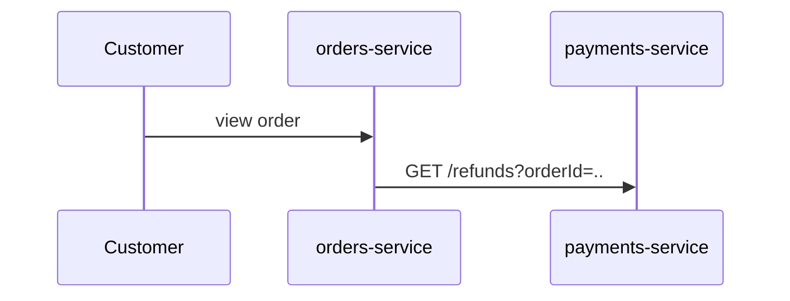

# {EPIC} {Feature name} - Solution design

- Jira epic: {EPIC}   Architect: {name}
- Sources: one pager {link v}, HLD {link v}, catalog synced on {date}
- Status: Draft until the architect approves it in Jira. Short on purpose: decisions and the
  block below, not a specification of every class (each team's LLD does that).

## 1. Requirements

Numbered, one testable sentence each (EARS: "When <trigger>, the <system> shall <response>."
or "The <system> shall <response>."). Questions for product go to section 7, not into guesses.

- R-01: When a paid order is less than 30 days old, the payments service shall accept a refund request.
- R-02: When a refund is requested, the orders service shall show the refund status on the order.

## 2. Impact analysis

How the components were chosen: the impact-analyst runs (k = 3), what they agreed on, what was
disputed and how it was decided.

| Component | Runs that named it | Decision | Evidence |
| --- | --- | --- | --- |
| payments-service | 3/3 | in | PaymentService.java:42 |
| notification-service | 1/3 | ruled out: already notifies on any status change | NotificationListener.java:17 |

## 3. Decisions

ADR style: the decision, the options considered (at most three), why this one.

## 4. Contracts

The exact contract changes (OpenAPI / AsyncAPI fragments). Additive by default; a breaking
change needs an expand -> migrate -> contract plan here.

## 5. Sequence



## 6. Rollout

Merge and deploy order (providers first), feature flags, data migration, rollback.

## 7. Open questions

## 8. The block the tool reads

```yaml
# sdlc-solution
requirements: [R-01, R-02]
components:
  - name: payments-service            # catalog name
    role: provider                    # provider | consumer | both | internal
    change: new refund endpoint and RefundRequested event
    requirements: [R-01]
    evidence: [src/main/java/com/acme/payments/PaymentService.java:42]
  - name: orders-service
    role: consumer
    change: show refund status on the order
    requirements: [R-02]
ruledOut:
  - {name: notification-service, reason: already notifies on any order-events status change}
disputed: []                          # must be empty to publish
contracts:
  - provider: payments-service
    api: payments-api                 # catalog API name
    add: ["POST /orders/{orderId}/refunds"]
    remove: []
    compatibility: additive           # additive | breaking
  - {provider: payments-service, api: payment-events, add: ["message RefundRequested on refund-events"], compatibility: additive}
order: [payments-service, orders-service]
```
